<div align="center">


# PrepPilot

**AI-powered interview preparation: learn a topic with an AI tutor, test yourself, then sit a timed mock interview.**

[](https://prep-pilot-ui.vercel.app)


[**Open the live app**](https://prep-pilot-ui.vercel.app) &nbsp;·&nbsp; [Features](#features) &nbsp;·&nbsp; [Architecture](#architecture) &nbsp;·&nbsp; [Run it locally](#run-it-locally) &nbsp;·&nbsp; [Deployment](#deployment)

<br>

<picture>
  <source media="(prefers-color-scheme: dark)" srcset="frontend/public/how-it-works/dark/sign-in.webp">
  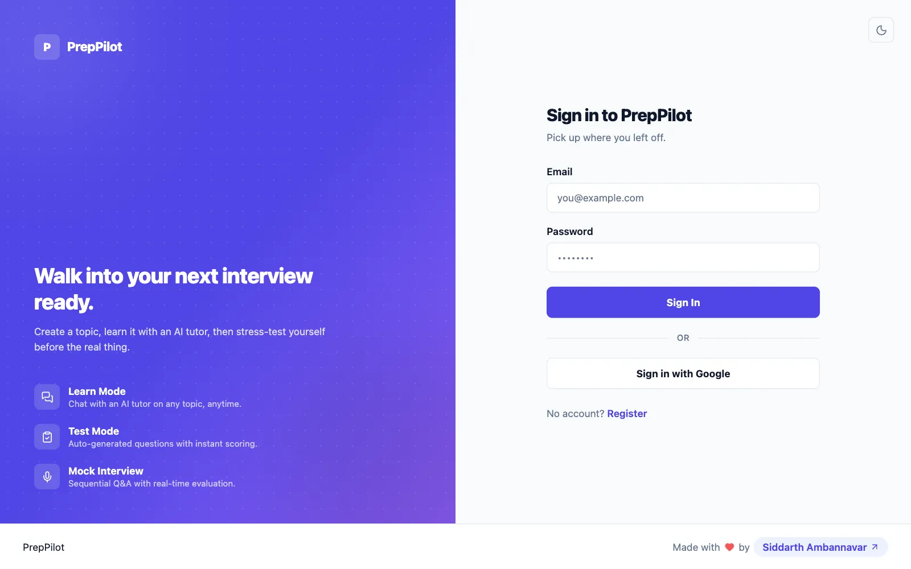
</picture>

</div>

## What it does

You add the topics you are preparing for, such as Spring Boot, DBMS, System Design or any other technical subject, and practise each one in three modes. Every chat, test and interview is saved, and every report points you to the next step.

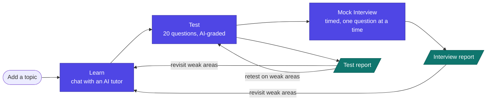

## Features

<table>
  <tr>
    <td width="56%">
      <picture>
        <source media="(prefers-color-scheme: dark)" srcset=".github/assets/learn-mode-dark.webp">
        
      </picture>
    </td>
    <td valign="top">
      <h3>💬 Learn Mode</h3>
      <p>A chat with an AI tutor that first asks what you already know and how deep you want to go, then teaches.</p>
      <ul>
        <li>Answers stream in as they are written, with headings, examples and code</li>
        <li>One saved chat per topic, so you can pick up where you left off</li>
        <li>Off-topic questions get a polite nudge back to your preparation</li>
      </ul>
    </td>
  </tr>
  <tr>
    <td width="56%">
      <picture>
        <source media="(prefers-color-scheme: dark)" srcset="frontend/public/how-it-works/dark/test-report.webp">
        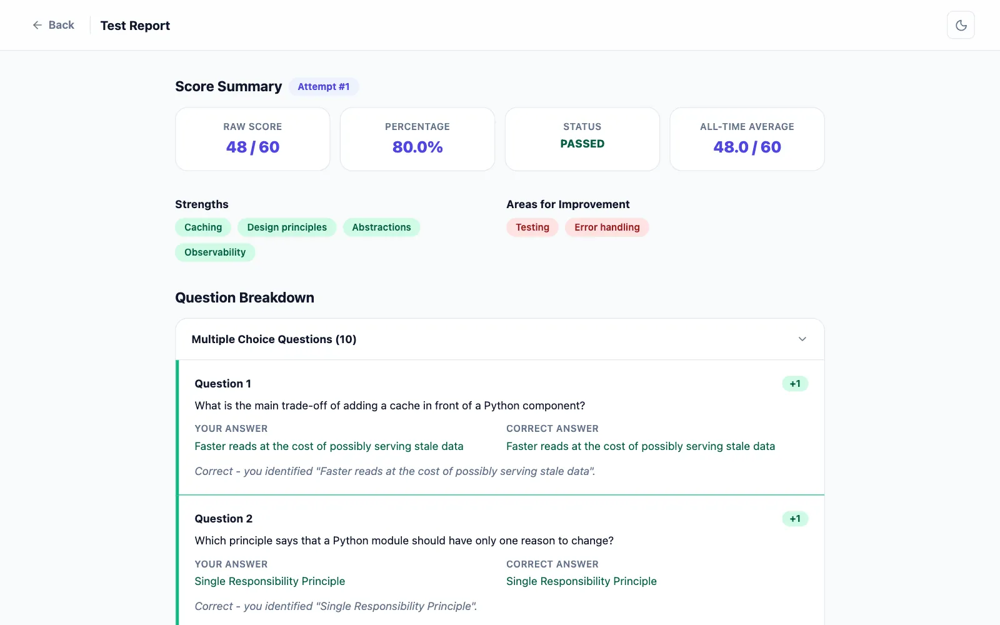
      </picture>
    </td>
    <td valign="top">
      <h3>📝 Test Mode</h3>
      <p>A freshly written 20-question test for your topic and level: 10 multiple-choice and 10 written.</p>
      <ul>
        <li>Written answers are graded by AI against a model answer</li>
        <li>Multiple-choice scores +1 or −1, written +5 or −5, blank 0. Maximum 60, pass at 36</li>
        <li>The report lists strengths, areas to improve and feedback on every question</li>
        <li>A retest focuses on what you got wrong last time</li>
      </ul>
    </td>
  </tr>
  <tr>
    <td width="56%">
      <picture>
        <source media="(prefers-color-scheme: dark)" srcset="frontend/public/how-it-works/dark/interview-feedback.webp">
        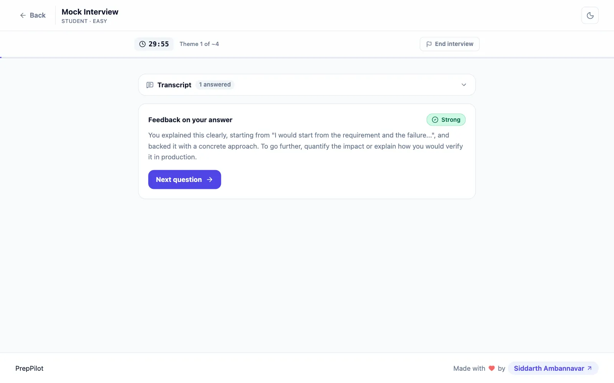
      </picture>
    </td>
    <td valign="top">
      <h3>🎤 Mock Interview</h3>
      <p>One question at a time on a 30, 45 or 60 minute clock that does not pause.</p>
      <ul>
        <li>Each answer is rated Strong, Satisfactory or Needs work, with feedback</li>
        <li>A strong answer can earn a follow-up question, as a real interviewer would ask</li>
        <li>The final report gives a score out of 100, an overall assessment, and model answers for the questions you struggled with</li>
      </ul>
    </td>
  </tr>
</table>

**Also included**

- **Prep tracks.** Two onboarding questions (your domain and your experience) set the level of everything. College students get the placement track; everyone else gets the professional track and picks the interview level and difficulty.
- **Reports and history.** Every test and interview is kept. Reopen any report, or press **Revisit** to go straight back to Learn Mode for that topic.
- **Sign in your way.** Email and password, or Google.
- **Private by default.** Each user sees only their own topics, chats and reports.
- **Light and dark themes**, plus a guided tour of the app at `/how-it-works`.
- **Read-only admin pages** (`/admin`) for the owner: user list, topic names, and counts of tests and interviews. Admins cannot see scores, answers, reports or chats. A **Feedback** button on every page sends messages to an admin inbox.

<details>
<summary><b>More screenshots</b></summary>

<br>

<table>
  <tr>
    <td width="50%" align="center">
      <picture>
        <source media="(prefers-color-scheme: dark)" srcset="frontend/public/how-it-works/dark/onboarding.webp">
        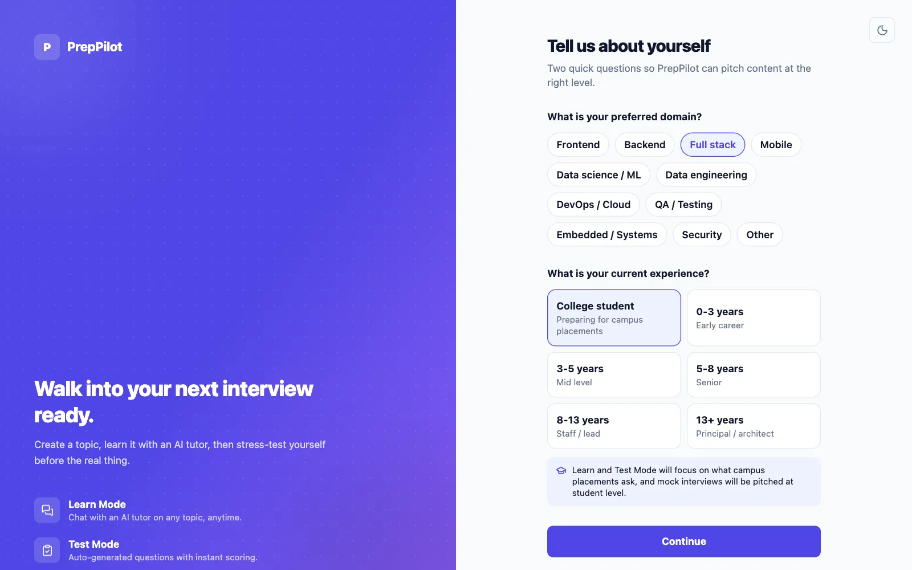
      </picture>
      <br><sub>Onboarding: domain and experience</sub>
    </td>
    <td width="50%" align="center">
      <picture>
        <source media="(prefers-color-scheme: dark)" srcset="frontend/public/how-it-works/dark/test-questions.webp">
        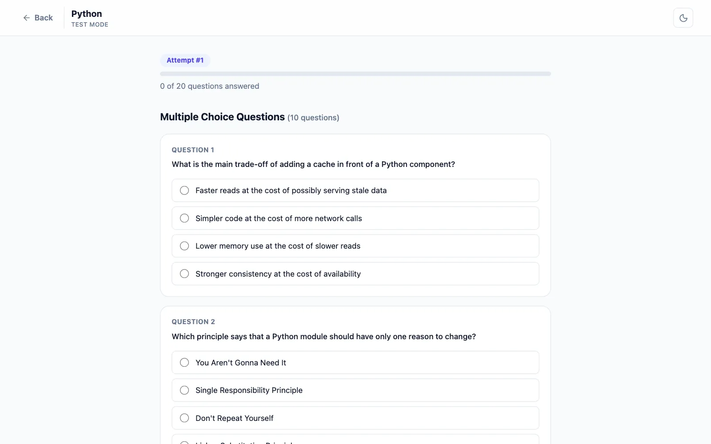
      </picture>
      <br><sub>Test Mode: multiple-choice section</sub>
    </td>
  </tr>
  <tr>
    <td align="center">
      <picture>
        <source media="(prefers-color-scheme: dark)" srcset="frontend/public/how-it-works/dark/test-results.webp">
        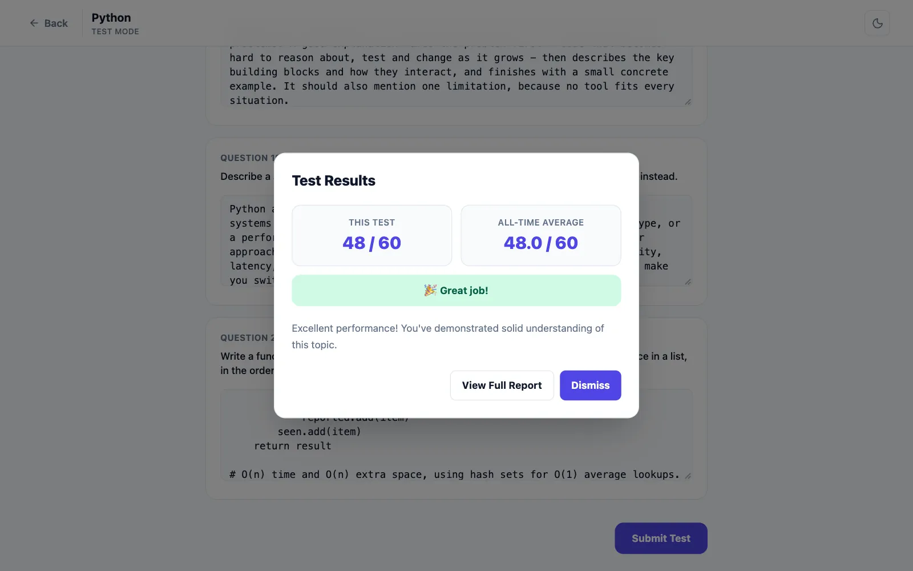
      </picture>
      <br><sub>Test Mode: instant result</sub>
    </td>
    <td align="center">
      <picture>
        <source media="(prefers-color-scheme: dark)" srcset="frontend/public/how-it-works/dark/test-retest.webp">
        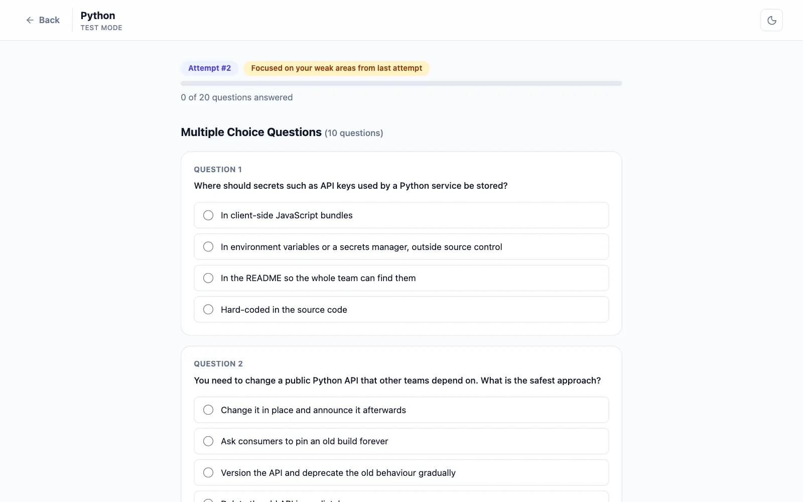
      </picture>
      <br><sub>Retest built from your weak areas</sub>
    </td>
  </tr>
  <tr>
    <td align="center">
      <picture>
        <source media="(prefers-color-scheme: dark)" srcset="frontend/public/how-it-works/dark/interview-question.webp">
        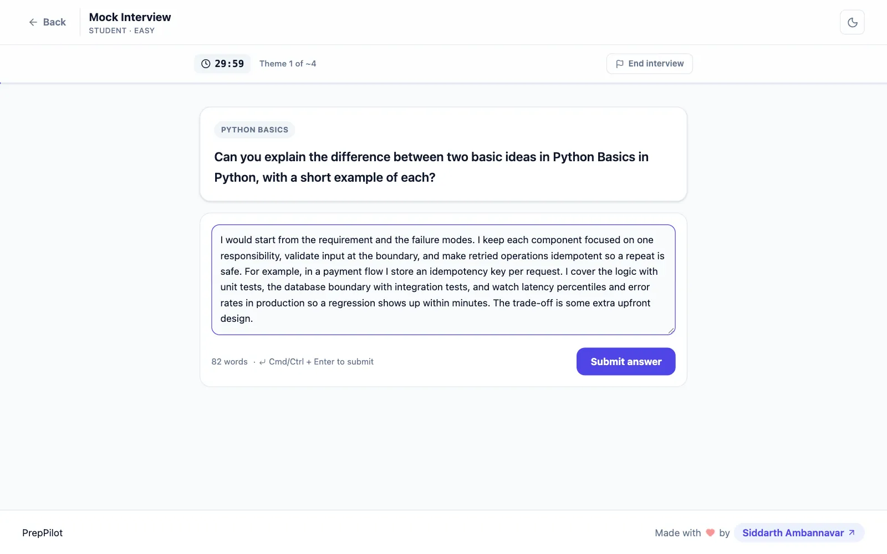
      </picture>
      <br><sub>Mock Interview: answering on the clock</sub>
    </td>
    <td align="center">
      <picture>
        <source media="(prefers-color-scheme: dark)" srcset="frontend/public/how-it-works/dark/interview-report.webp">
        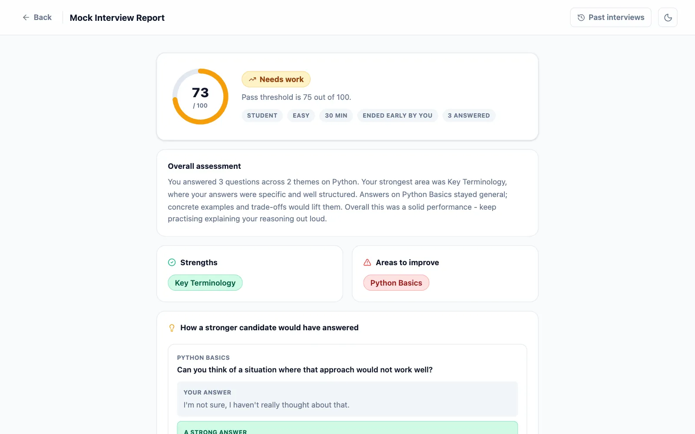
      </picture>
      <br><sub>Interview report: score and assessment</sub>
    </td>
  </tr>
  <tr>
    <td align="center">
      <picture>
        <source media="(prefers-color-scheme: dark)" srcset="frontend/public/how-it-works/dark/interview-model-answers.webp">
        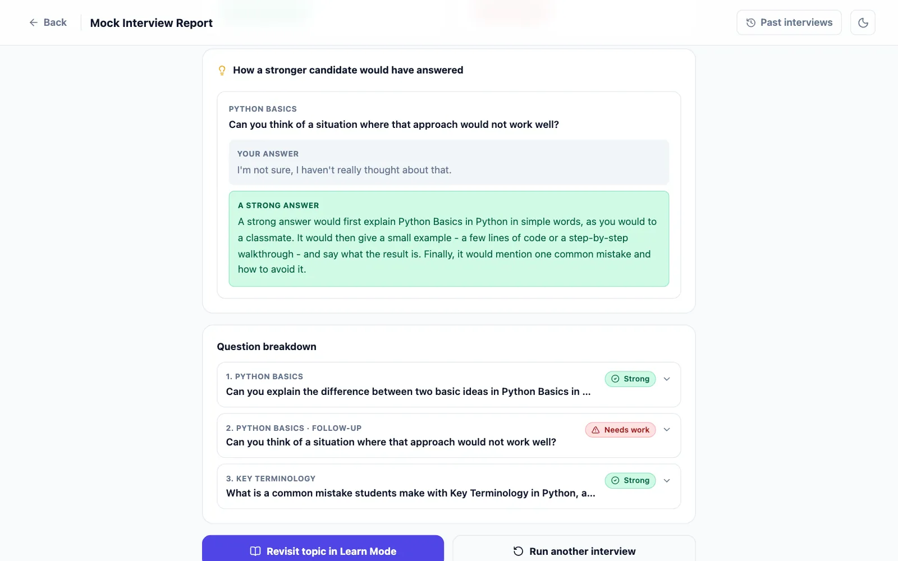
      </picture>
      <br><sub>How a stronger candidate would have answered</sub>
    </td>
    <td align="center">
      <picture>
        <source media="(prefers-color-scheme: dark)" srcset="frontend/public/how-it-works/dark/interview-history.webp">
        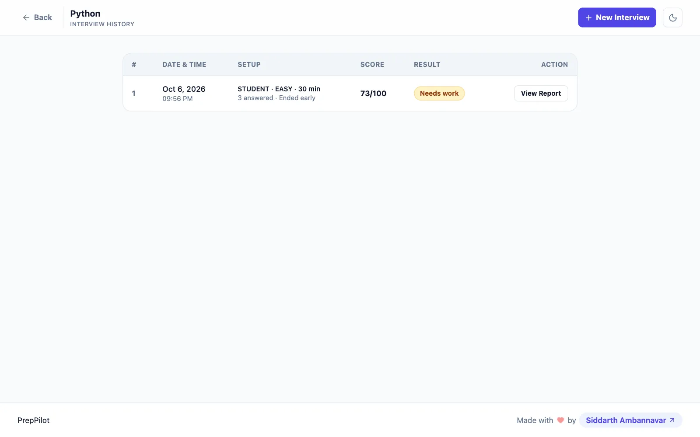
      </picture>
      <br><sub>Interview history</sub>
    </td>
  </tr>
</table>

Screenshots follow your GitHub theme (light or dark).

</details>

## Tech stack

<p align="center">
  
</p>

| Layer | Technology |
|---|---|
| **Frontend** | React 18, TypeScript 5, Vite 5, Tailwind CSS 4, Redux Toolkit (auth and UI state), TanStack Query (server state), React Router 6, Axios |
| **API Gateway** | Spring Cloud Gateway on Spring Boot 3.3, Java 21 |
| **User Service** | Spring Boot 3.3, Spring Security with the Google OAuth2 client, Spring Data MongoDB, JJWT, BCrypt |
| **Topic Service** | Spring Boot 3.3 (MVC plus WebClient for streaming), Spring Data MongoDB, Caffeine cache |
| **AI Service** | FastAPI, Uvicorn, Pydantic 2, OpenAI SDK. Talks to OpenAI, or to Gemini through its OpenAI-compatible endpoint |
| **Data** | MongoDB 7 with two databases: `users_db` and `topics_db` |
| **Tooling** | Gradle 8 (Kotlin DSL), Docker Compose, Playwright, GitHub Actions |
| **Hosting** | **AWS EC2** for the backend services, Vercel for the frontend and the AI Service, MongoDB Atlas for data |

## Architecture

> [!TIP]
> The diagrams in this README are interactive on GitHub. Hover one for zoom and pan controls, or open it full screen. Sections marked with ▸ expand when you click them.

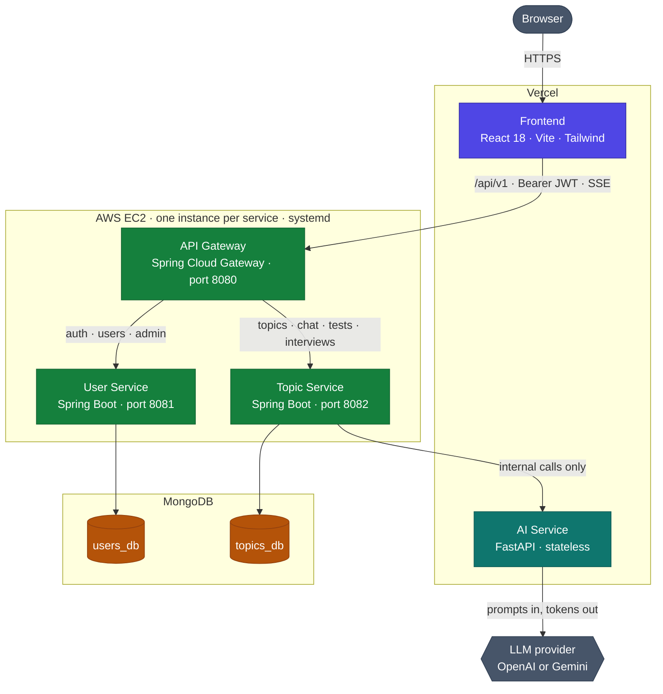

| Service | Port | What it does | Code |
|---|---|---|---|
| **API Gateway** | 8080 | The single entry point. Verifies the JWT, adds `X-User-Id`, `X-User-Email` and `X-User-Experience` from its claims, routes by path, handles CORS, and turns non-admins away from `/api/v1/admin/**` | [`preppilot-backend/gateway`](preppilot-backend/gateway) |
| **User Service** | 8081 | Registration, login, Google OAuth, refresh-token rotation, profile and onboarding answers, feedback, the admin user list | [`preppilot-backend/user-service`](preppilot-backend/user-service) |
| **Topic Service** | 8082 | Topics, Learn chats, tests, mock interviews and reports. The only service allowed to call the AI Service | [`preppilot-backend/topic-service`](preppilot-backend/topic-service) |
| **AI Service** | 8000 | Stateless. Builds prompts, keeps conversations on technical topics, calls the LLM, and streams tokens over SSE | [`ai-service`](ai-service) |
| **MongoDB** | 27017 | `users_db` holds users, refresh tokens and feedback. `topics_db` holds topics, chats, tests, interviews and reports | |

**Design choices worth knowing**

- **Identity comes only from a verified token.** The gateway sets `X-User-Id` from the JWT. User Service and Topic Service verify the same token again and overwrite that header, so calling them directly without a valid token does not work.
- **The AI Service is stateless and not open to the public.** Every request carries the full context, and only Topic Service can call it. Users reach the LLM only through Topic Service.
- **Streaming end to end.** Tokens flow from the LLM through the AI Service, Topic Service and the gateway to the browser as Server-Sent Events.
- **One switch for the LLM provider.** A single setting selects OpenAI or Gemini, with no code change.
- **Interviews do not get stuck.** If an AI call fails mid-interview, Topic Service asks a built-in fallback question and the session carries on.

## How it works

<details>
<summary><b>Sign-in and token refresh</b></summary>

<br>

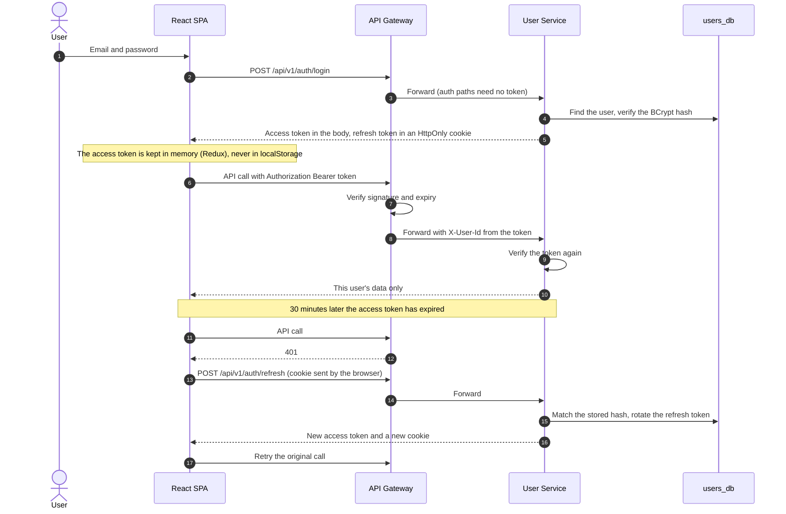

Google sign-in uses the same tokens. The browser goes to `/oauth2/authorization/google`, Google redirects back to `/login/oauth2/code/google`, and User Service sets the refresh cookie and sends the browser to `/auth/callback` with the access token in the URL fragment.

</details>

<details>
<summary><b>Learn Mode: a streamed chat reply</b></summary>

<br>

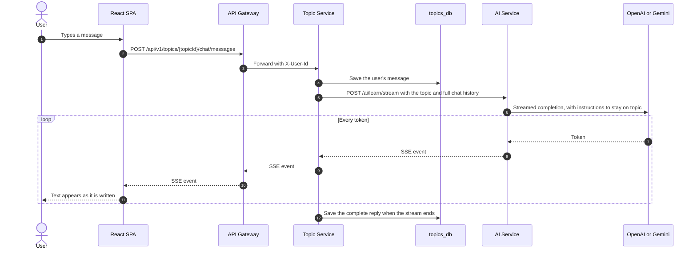

</details>

<details>
<summary><b>Test Mode: generate, grade, report</b></summary>

<br>

The gateway sits between the browser and Topic Service on every call; it is left out here to keep the diagram short.

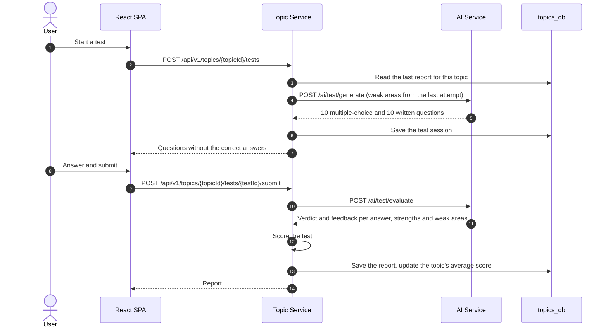

</details>

<details>
<summary><b>Mock Interview: the life of a session</b></summary>

<br>

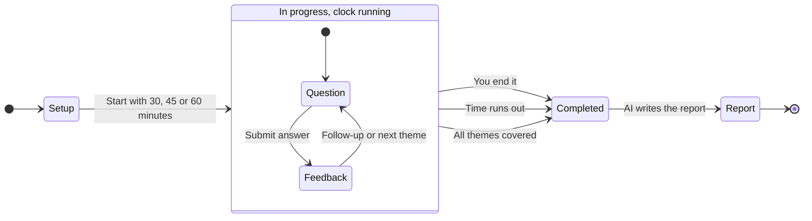

Topic Service calls three AI endpoints: `/ai/interview/plan` once at the start to choose the themes, `/ai/interview/next-turn` after each answer for the rating, feedback and next question, and `/ai/interview/generate-report` at the end. You can leave and resume an interview that is in progress, but its clock keeps running while you are away.

</details>

<details>
<summary><b>Data model</b></summary>

<br>

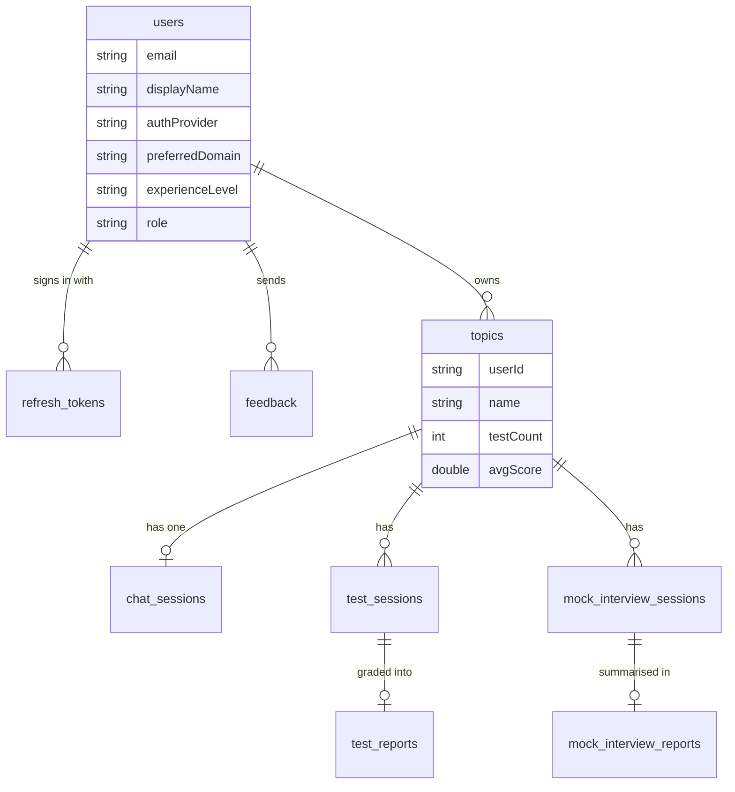

`users`, `refresh_tokens` and `feedback` live in `users_db`. Everything else lives in `topics_db` and refers to the user by id only.

</details>

## Run it locally

The repository ships a self-contained stack that runs the whole application on your machine: the frontend, the gateway, both Spring services, the AI Service, its own MongoDB, and a fake LLM that stands in for the real model. It needs no accounts and no configuration.

**You need** [Git](https://git-scm.com/downloads) and [Docker](https://docs.docker.com/get-docker/) (Docker Desktop, or Docker Engine with Compose v2). Nothing else has to be installed, because Java, Node.js and Python all run inside the containers.

1. **Clone the repository.**

   ```bash
   git clone https://github.com/siddarth-ba-72/Interview-Prep-Pilot-AI.git
   cd Interview-Prep-Pilot-AI
   ```

2. **Build and start every service.** The command returns once all of them are healthy. The first run takes several minutes while the images download their dependencies; later starts take seconds.

   ```bash
   docker compose -f loadtest/docker-compose.yml up --build -d --wait
   ```

3. **Open [http://localhost:3000](http://localhost:3000)**, choose **Register**, and create an account with any email and password.

4. **Use the app.** Answer the two onboarding questions, add a topic such as Python, then try Learn, Test and Mock Interview.

5. **Stop the stack** when you are done. Your data is kept for the next start.

   ```bash
   docker compose -f loadtest/docker-compose.yml down
   ```

**Good to know**

- AI answers come from a built-in bank of realistic replies, delivered at roughly the speed of a real model. Generating a test takes 30 to 50 seconds.
- Google sign-in is not available in the local stack. Use email and password.
- The stack uses ports 3000 (app), 8080 (API), 8090 (fake LLM) and 27019 (MongoDB). Free them before you start.
- The root `docker-compose.yml` runs the same services against a real LLM provider. It needs per-service environment files that are not part of this repository.

| If you see | Do this |
|---|---|
| A "port is already allocated" error | Something else is using port 3000 or 8080. Stop it and run step 2 again |
| The first build seems stuck | It is downloading Gradle, npm and pip dependencies. Give it a few minutes |
| You are signed out when you reload the page | Use Chrome or Firefox for local work. They keep the session cookie on `http://localhost` |

## Project structure

| Path | What it holds |
|---|---|
| [`frontend/`](frontend) | React and TypeScript single-page app: pages, feature modules, the API client, and the product screenshots |
| [`preppilot-backend/gateway/`](preppilot-backend/gateway) | Spring Cloud Gateway: routing, token check, CORS |
| [`preppilot-backend/user-service/`](preppilot-backend/user-service) | Sign-in, Google OAuth, profiles, feedback, the admin user list |
| [`preppilot-backend/topic-service/`](preppilot-backend/topic-service) | Topics, chats, tests, interviews, reports, and the client for the AI Service |
| [`preppilot-backend/cache-service/`](preppilot-backend/cache-service) | Shared Caffeine cache library, built into the other services |
| [`ai-service/`](ai-service) | FastAPI app: prompts, scope guardrails, LLM calls |
| [`loadtest/`](loadtest) | The local stack with a fake LLM, plus the load-test runner |
| [`e2e/`](e2e) | Playwright end-to-end tests and load journeys |
| [`deploy/`](deploy) | EC2 setup script and systemd units |
| [`.github/workflows/`](.github/workflows) | Lint, build, deploy and rollback pipelines |

## Testing

None of the automated tests call a real LLM. The browser tests run against the local stack described above.

- **Unit tests** for the Java services run in the deploy pipeline before every build.
- **End-to-end tests** in [`e2e/`](e2e) are Playwright specs that cover sign-in, the dashboard, Learn Mode, Test Mode, Mock Interview and feedback. See [`e2e/README.md`](e2e/README.md).
- **Load tests** in [`loadtest/`](loadtest) run realistic browser journeys with smoke, stress, soak and chaos profiles, and report response-time percentiles for each step. See [`loadtest/README.md`](loadtest/README.md).
- **Contract tests** check that the fake LLM still matches the prompts the AI Service sends.

## Deployment

| Part | Where it runs |
|---|---|
| **API Gateway, User Service, Topic Service** | **AWS EC2.** Each service has its own instance and runs as a Spring Boot jar under systemd |
| **Frontend** | Vercel. It forwards API and OAuth requests to the gateway, so the browser only ever talks to one origin |
| **AI Service** | Vercel, as a Python function |
| **MongoDB** | MongoDB Atlas |

### Backend on AWS EC2

Each of the three Java services is deployed independently by GitHub Actions. A push to `main` deploys only the services whose code changed; a change to the shared `cache-service` library redeploys all three.

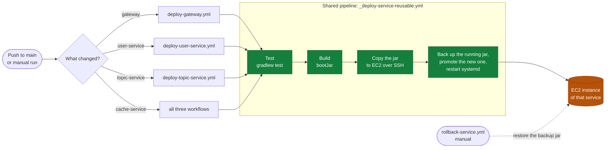

- **If the tests fail, nothing is deployed.**
- **Each instance keeps the previous jar.** Rollback is a manual workflow (Actions → *Rollback - Backend Service* → pick the service) that puts that jar back and restarts the service, with no rebuild.
- **systemd restarts a service** if it stops.
- **Setting up a new instance** is a one-time manual step. The walkthrough is in [`deploy/README.md`](deploy/README.md).

## Security

- **Sessions.** A short-lived access token is held in memory, never in `localStorage`. A longer-lived refresh token sits in an `HttpOnly`, `Secure` cookie and is rotated every time it is used.
- **Passwords** are hashed with BCrypt.
- **User identity** always comes from the verified token, at the gateway and again inside each service. It is never read from a request body or from a header the client controls.
- **The AI Service** takes requests only from Topic Service, so nobody can reach the LLM directly.
- **Admins** are read-only and see counts, not content.
- **Analytics** (Microsoft Clarity) run only in production, receive a user id but no name or email, and mask answers, scores, reports and chats.

## Author

Built by **Siddarth Ambannavar** ([@siddarth-ba-72](https://github.com/siddarth-ba-72)).
